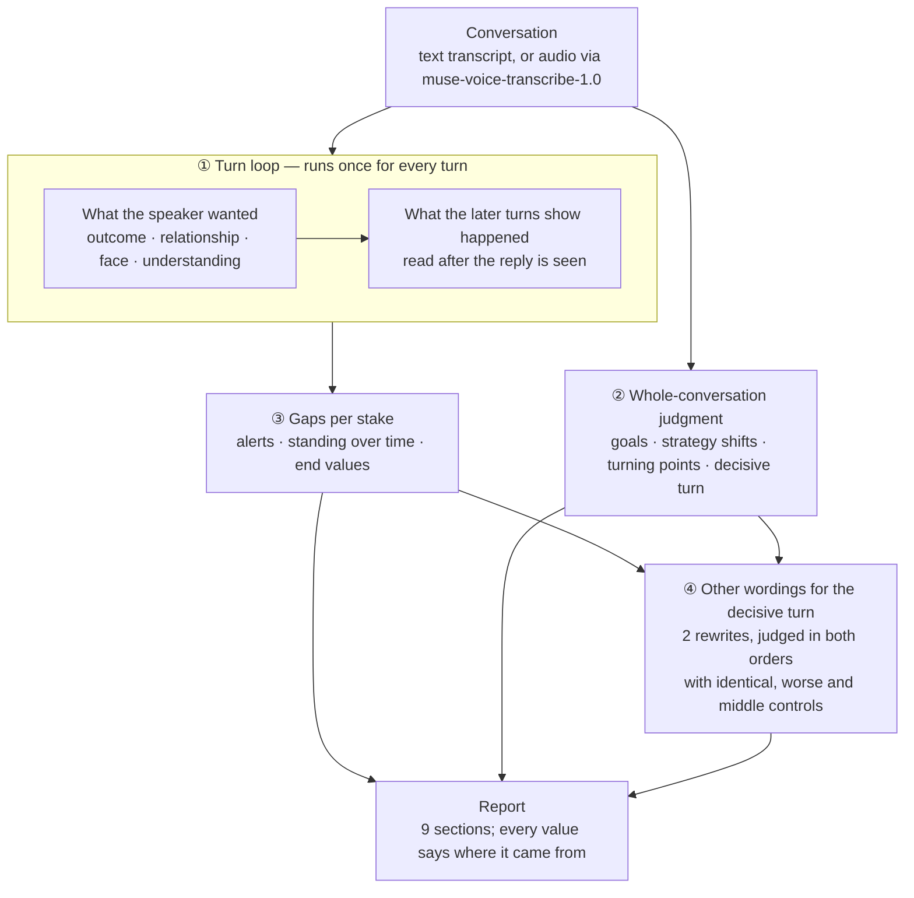

# Uptake

Reads important conversations turn by turn, showing where what each speaker wanted in outcome, relationship, face, and understanding diverged from what actually happened, and what remains against each speaker's own goals.

*Uptake* is J. L. Austin's word for how an utterance is actually taken
up by the listener. This tool is for looking back at high-stakes talk —
air traffic control, emergency calls, diplomacy, negotiation — to find
the moment a message did not land, and to try other wordings for it.
It is a debrief and training aid. It reads the utterance, not the person.

## Why

On 25 January 1990, Avianca 052 was holding near New York with little
fuel left. The crew told the controller several times that they were
"running out of fuel", but never used the word "emergency". The
controller heard a tight schedule, not a crisis, and the plane stayed
in line. It ran out of fuel and crashed; 73 of the 158 people on board
died.

Nobody lied and nobody stayed silent. What the crew wanted the words to
do and what the words did were far apart. Uptake makes that gap visible,
turn by turn.

## How it works



1. **Turn loop.** For each turn, the model reads what the speaker wanted
   on each of the four stakes, then what the following turns show
   actually happened on that stake. Judging after the reply is seen is
   the method: Uptake looks back, it does not guess ahead. One turn can
   gain on one stake and lose on another; stakes are never merged into
   one number.
2. **Whole-conversation judgment.** One reading of the full
   conversation names each speaker's goal, when their strategy shifted,
   the turning points and the decisive turn. It is labeled reference,
   not measurement. If a field fails its check, a code rule fills it
   and the report says so.
3. **Gaps.** Where wanted and happened are far apart, the turn gets an
   alert (advisory, caution, warning, critical) on that stake. The same
   readings give each speaker's standing over time and the values left
   at the end.
4. **Other wordings.** The model writes two rewrites of the decisive
   turn that keep its facts. A judge panel compares each with the
   original on the item that broke most, in both orders, ties counting
   half. Three controls run alongside: the original against itself
   (should land near 0.5), a deliberately worse wording (should lose),
   and a slightly better one. A judge that always prefers new wording
   fails these controls.

Every model call is cached by its input, so re-rendering a report costs
nothing. A run stops at its `--budget` and prints `SPEND=<usd>` last.

## What the report shows

| Section | Content |
|---|---|
| 1. What happened and how it ended | The case and its recorded outcome |
| 2. Goals and strategy shifts | Each speaker's own goal and when it changed |
| 3. Position and turning points | Standing per stake over time |
| 4. Alert timeline | Turns where wanted and happened diverged, by stake |
| 5. Intended, said, read | The decisive turn, side by side |
| 6. If it had been said differently | The rewrites and how they scored against the controls |
| 7. One line of perspective | A short reference note |
| 8. Plus and minus at the end | Measured end values per stake, on a −1 to +1 scale |
| 9. How much to trust this | Reliability figures and which values are reference only |

## Models

All model calls go to Meta's Muse models.

| Step | Model |
|---|---|
| Audio to speaker-labeled turns | `muse-voice-transcribe-1.0` |
| Move tagging, and the reader used for the reliability figures below | `muse-spark-1.3-contributor` |
| Reports on private high-stakes cases (`--model`) | `muse-spark-1.3` |

## Measured so far

Measured on CaSiNo negotiation dialogues (CC BY 4.0), on held-out sets
not used during development:

- **Move tagging:** micro F1 0.624 [0.569–0.677], macro F1 0.544
  [0.481–0.596] on 30 dialogues; majority baseline 0.289.
- **Per-turn reader reliability:** split-half 0.863 (k=8, 486 turns,
  40 dialogues).
- **Relation to how talks ended:** R1 +0.277 (134 dialogues) and +0.344
  (300 dialogues).
- **Response to wording changes:** deliberately ruder or more polite
  versions of a turn were ordered correctly in 0.8 of cases (20
  dialogues).
- **Other wordings:** the panel separates better from worse wording,
  but does not yet separate a slightly better wording from a good one.

Held-out check on high-stakes talk, run once after the code was frozen,
on three cases sampled before any were read (one UN Security Council
meeting, two emergency calls). Pass line: warning-or-critical alerts on
at most 20% of turns.

| Case | Turns | Warning or critical | Result |
|---|---|---|---|
| UN Security Council meeting 8105 (2017) | 53 | 0 (0.0%) | pass |
| Emergency call 1 | 33 | 7 (21.2%) | fail |
| Emergency call 2 | 29 | 4 (13.8%) | pass |

Two of three passed; the failing case missed the line by one turn.

Not measured yet: reliability of the per-turn reader on aviation,
emergency-call or diplomatic talk; whether end values match what
participants themselves report.

## Quick start

```sh
python3 -m venv .venv
source .venv/bin/activate
pip install -e .
export META_API_KEY=...
```

Case files are not in this repository. Put one case under
`data/private/highstakes/`:

- `casino-<case>_turns.jsonl` — one turn per line: `{"speaker": "A", "text": "..."}`
- `casino-<case>_case.json` — at least `title` and `outcome`

(The `casino-` prefix is a file-naming convention kept from the first
dataset; any case uses it.)

Build a report:

```sh
.venv/bin/uptake-report --case <case> --out out/<case> --model muse-spark-1.3 --budget 10
```

Try the first few turns only:

```sh
.venv/bin/uptake-report --case <case> --out out/trial --model muse-spark-1.3 --budget 1 --max-turns 5
```

Without `--model` the run makes no calls, spends $0.00, and leaves the
stake readings unclear. A full report on a 30–50 turn case took about
$5–13 and 20–90 minutes with `muse-spark-1.3`.

From audio:

```sh
uptake-transcribe --out turns.json meeting.wav
uptake-moves --turns turns.json --out moves.json
```

Evaluate move tagging on held-out dialogues:

```sh
uptake-eval-moves --casino <casino-dir> --n 30 --out eval.json
```

## Honest limits

- Uptake reads where an utterance did not land, after the reply is
  seen. It does not claim to know the right answer, and it makes no
  claim about what will happen next. It is not a live alarm.
- On the demo cases, alerts are frequent: in Avianca 052, 24 of 38
  turns carry an alert, and the US Airways 1549 success case also
  carries alerts on 10 of 22 turns. Read the alert timeline together
  with the end values, not alone.
- The reliability figures come from negotiation dialogues. They have not
  been re-measured on the high-stakes domains shown in the demo.
- Well-known cases may already be known to the model. Treat results on
  famous accidents as illustrations, not evidence.
- Simulated listeners are not real people. Panel reads are hints, not
  verdicts. Read the confidence intervals, not just the point values.
- Not a tool for judging anyone's personality or ability. It reads the
  utterance, not the person.
- For recorded conversations only, not advice. Record only conversations
  you take part in, and get consent first.

## Author

YOON SEUNGMI (seungmi0723@naver.com) — built for the Meta Global AI Developer Hackathon (Oct 27 – Nov 5, 2026).
